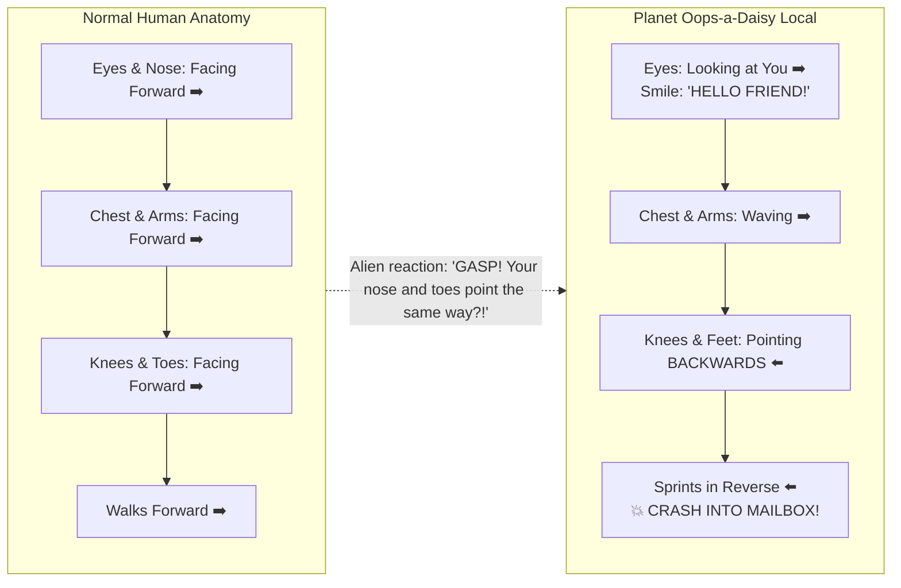
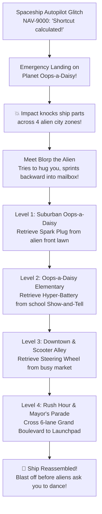
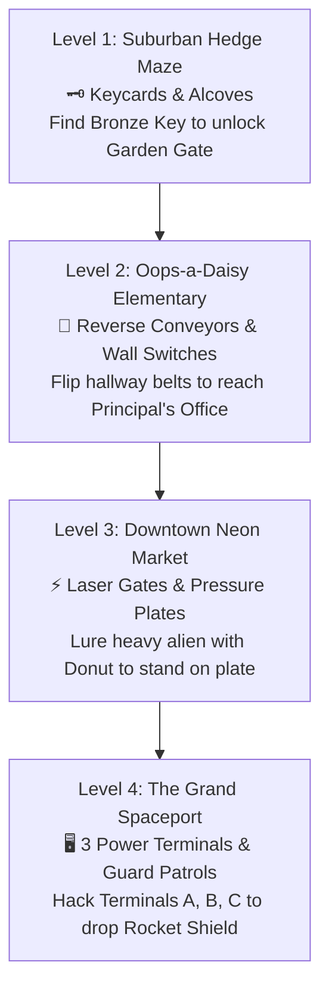
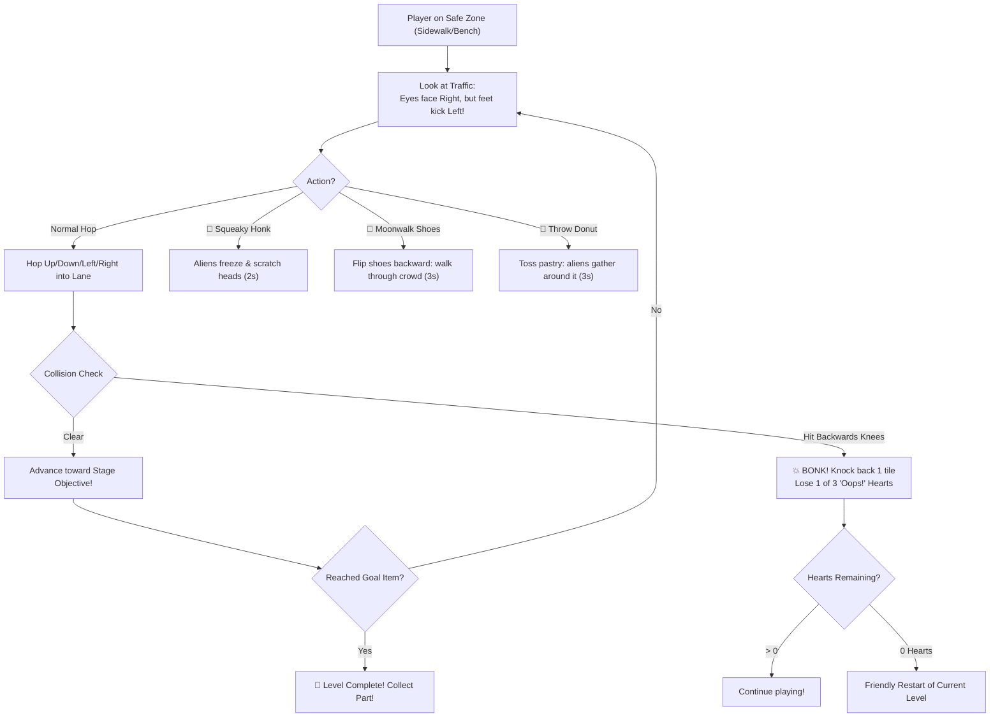
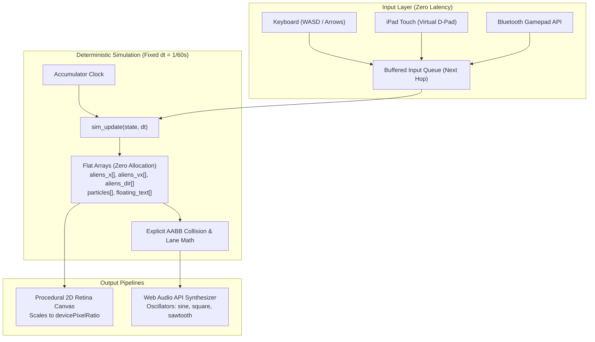
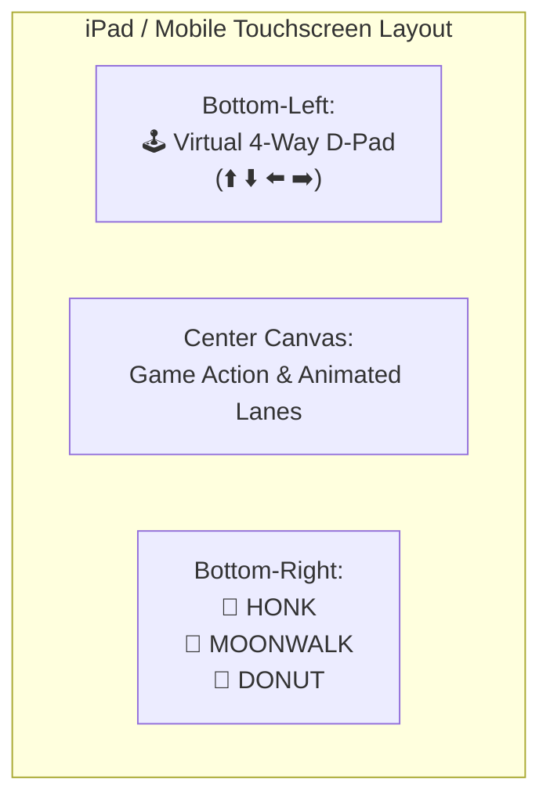

# 🚀 Planet Oops-a-Daisy: The Confused Alien Crossing
### *Complete Project Plan, Backstory, Decisions & Technical Architecture*

---

## 📌 1. Project Overview & Origin Story

This project is a collaborative game creation based on a funny story made up by a parent and their kid. 

### The Core Premise & Joke
* A human lands on a strange alien planet.
* **The Anatomical Twist:** The aliens' upper bodies (head, eyes, mouth, arms, torso) face forward normally, smiling and talking directly to you. **However, their lower bodies (legs, knees, and feet) are completely reversed!** Their knees bend backward, their feet face the opposite direction, and when they try to walk forward, they kick in reverse.
* When an alien runs toward you to greet you, their legs sprint at full speed in the opposite direction!
* To the locals of this planet, **the human is the weird alien freak** because *"your nose and toes point in the exact same direction!"*

---

## 📖 2. The Storyline & World-Building

### Setting: **Planet Oops-a-Daisy**
A colorful, bustling alien world characterized by wobbly architecture, lavender lawns, backwards crosswalks, and constant accidental collisions.

### Characters:
1. **Leo the Tourist (Player):** 
   - An accidental tourist wearing a vacation Hawaiian shirt over a round-helmet spacesuit.
   - Normal human anatomy with forward-facing sneakers.
2. **NAV-9000 (Spaceship AI Autopilot):**
   - The reason Leo is here! The AI took a "scenic shortcut" around Jupiter, suffered a glitch, and made an emergency landing on Planet Oops-a-Daisy.
   - Speaks through Leo’s helmet/wrist communicator. Overly cheerful, deadpan GPS personality that never admits making a mistake.
   - Gives Leo comical, unhelpful survival tips.
3. **Blorp (The First Encounter):**
   - A friendly alien receptionist who shouts *"WELCOME TRAVELER!"* and tries to hug Leo, but immediately sprints backward into a mailbox.
4. **The Citizens of Oops-a-Daisy:**
   - Texting commuters who walk backward into trashcans.
   - Kids at the alien school running recess tag in reverse.
   - Commuters riding backwards kick-scooters while sipping alien smoothies.
   - Mayor Oopsie, leader of the planet, riding a backwards parade float.

---

## 🗺️ 3. The 4-Level Maze Adventure & Unique Puzzle Mechanics

Instead of a simple road crossing, each level is a **2D Top-Down Maze Labyrinth** with walls, corridors, dead ends, and a **completely new puzzle mechanic to solve**:

| Level | Maze Setting | Primary Item | Unique Puzzle Mechanic |
| :--- | :--- | :--- | :--- |
| **Level 1** | **Suburban Hedge Maze** | ⚡ Spark Plug | **Keycards & Nooks:** Find the hidden Bronze Keycard in garden alcoves to unlock the electronic gate. Hide in cutouts when backward neighbors patrol past. |
| **Level 2** | **Oops-a-Daisy Elementary** | 🔋 Hyper-Battery | **Reverse Conveyors & Wall Levers:** Hallway moving walkways pull you backward unless you flip the wall switch or use Moonwalk Shoes. |
| **Level 3** | **Downtown Neon Market** | 🛞 Steering Wheel | **Laser Barriers & Pressure Plates:** Laser forcefields block paths. Toss a Donut onto floor plates to lure heavy aliens to hold the gates open! |
| **Level 4** | **The Grand Spaceport** | 🔑 Launchpad Rocket | **3 Terminal Codes & Searchlights:** Hack Energy Terminals A, B, and C in 3 quadrants of the high-security complex to lower the rocket forcefield! |

---

## ⏱️ 4. Difficulty Modes & Time Limits

Players can choose their challenge level directly from the Title Screen:

| Setting | 🟢 Easy Mode | 🟡 Medium Mode | 🔴 Hard Mode |
| :--- | :--- | :--- | :--- |
| **Time Limit** | 180 seconds (3 mins) | 90 seconds (1.5 mins) | 50 seconds (Intense!) |
| **"Oops!" Hearts** | 5 Hearts | 3 Hearts | 2 Hearts |
| **Patrol Speed** | Slow & relaxed | Normal rhythm | Fast & sharp turns |
| **Gadget Cooldowns** | Quick recharge (4s) | Standard (6-8s) | Longer recharge (10s) |
| **Recommended For** | Younger kids / exploration | Standard arcade fun | Brainy speedrunners! |

---

## 🕹️ 4. Gameplay Mechanics & Controls

### Movement & Arcade Decision Loop

### Leo’s Tourist Utility Belt (All 3 Abilities Included)
1. **🎺 Squeaky Honk (Key: `1` or `Space` / Mobile Button):**
   - Leo honks an absurd rubber clown horn.
   - Nearby aliens freeze and scratch their heads in utter confusion for 2 seconds.
2. **👟 Reverse Shoes / Moonwalk (Key: `2` or `Shift` / Mobile Button):**
   - Leo puts on backward slip-on shoes for 3 seconds.
   - Leo blends in! Aliens don't bump you, and you can slip right through traffic unharmed.
3. **🍩 Space Donut Toss (Key: `3` or `E` / Mobile Button):**
   - Throw a sparkling alien donut onto a lane.
   - Distracts alien kids, dogs, and commuters who gather around the pastry for 3 seconds.

### Lives & Fail State ("Oops!" Hearts)
* **3 "Oops!" Hearts per level:**
  * Bumping into an alien's backwards knees triggers a cartoon *"BONK!"* sound, dizzy stars above Leo's helmet, and gently knocks him back one lane.
  * Losing 3 hearts restarts the current level (encouraging, kid-friendly, no punishing game-overs).
  * Floating heart pickups occasionally appear on safe islands to restore health.

---

## ⚙️ 5. Engineering Architecture (Muratori / Acton / Blow Principles)

### Key Architectural Tenets:
1. **Zero Garbage Collection Allocation in the Hot Loop (Mike Acton / Data-Oriented):**
   * Pre-allocated static arrays for all entities (`aliens_x`, `aliens_vx`, `particles`).
   * Zero `new` inside `requestAnimationFrame`: avoids garbage collection frame drops.
2. **Fixed-Step Deterministic Simulation (Jonathan Blow):**
   * Decoupled physics clock from display refresh rate: moves identically on 60Hz and 120Hz screens.
3. **Explicit Axis-Aligned Bounding Box Math (Casey Muratori):**
   * Direct, readable collision calculations with no physics middleware bloat.

---

## 📱 6. Multi-Device & iPad Touch Controls

* **Desktop / Mac:** Keyboard (`WASD` / Arrow keys + numbers `1, 2, 3` / `Spacebar`).
* **iPad / Mobile:** Two-thumb touch controls (D-Pad on left, 3 gadget buttons on right).
* **"Add to Home Screen":** Opens in full-screen standalone mode with zero browser address bars!

---

## 🎨 7. Art & Sound Design

### Visual Art Style (Procedural Retina Vector Graphics)
* Crisp vector paths rendered directly to Canvas, scaling dynamically to `devicePixelRatio`.
* **Alien Procedural Animation:**
  - Torso faces forward, arms wave, big expressive eyes.
  - Legs bend backwards and pedal in reverse.
  - Comical thought-bubble arrow over their heads showing where they *intend* to go vs where their feet take them.

### Real-Time Web Audio Synthesizer (Zero External Audio Files)
* All sounds generated via Web Audio API oscillators:
  - **Hop:** Upward chirping blip.
  - **Bonk:** Downward cartoon slide-whistle + dizzy tone.
  - **🎺 Squeaky Honk:** Dual-frequency clown horn squeak.
  - **👟 Moonwalk:** Retro slide groove tone.
  - **🍩 Donut:** Cartoon whoosh + crunch.
  - **Victory Fanfare:** Upbeat 8-bit brass arpeggio.
  - **Music:** Toggleable goofy walking chiptune bassline.
